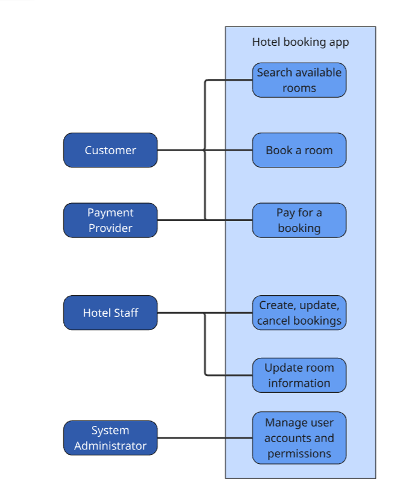
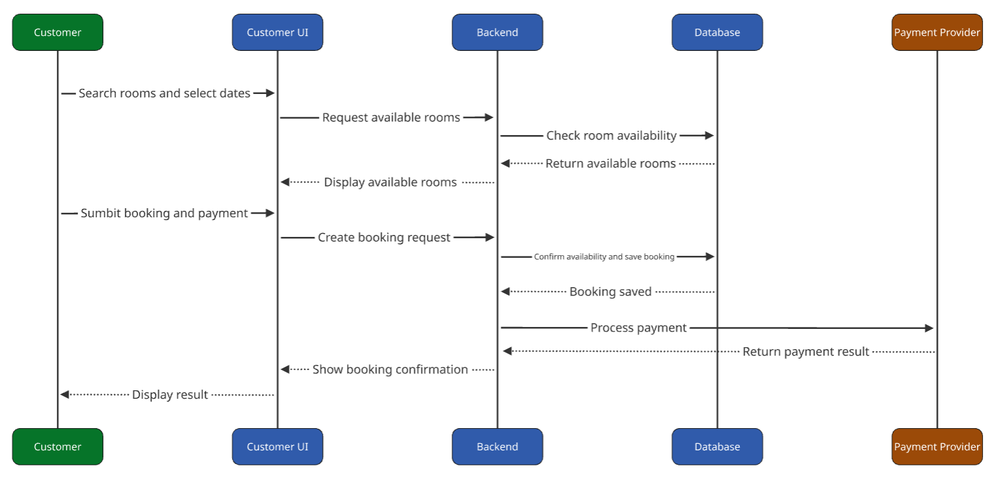

# Assignment I (Project Requirements Specification)
## Team members
Tony Thesslund / e2101348

## Problems
The objective of this teamwork assignment is to identify, structure, and prioritise the requirements for the project application. The team should develop a clear understanding of what the application needs to accomplish, who will use it, and what technical and quality characteristics it must fulfill.

## 1. Identify the Stakeholders and User Needs

Start by identifying the main stakeholders and potential users of the application. Consider their different needs, expectations, and responsibilities.

### Stakeholders
| Stakeholder | Needs | Expectations | Responsibilities |
|---|---|---|---|
| Hotel owners | A working software solution. | A working software solution. | Cooperate with the development team and their IT team; attend progress meetings and provide feedback. |
| System administrators | A working solution and training. | A secure, stable, maintainable system. | Understand the software, manage accounts and permissions, and provide feedback. |
| Hotel staff | An intuitive application, easy access to information, and training. | Easy-to-use tools for finding and modifying information. | Learn the application and provide feedback. |
| Customers | View, book, and pay for available rooms. | An intuitive, responsive interface and a simple booking process. | N/A |
| Development team | Clear requirements and feedback. | Communication and feedback from stakeholders. | Design, develop, test, and maintain the application. |

## 2. Define the Overall Application Requirements

Develop a set of requirements for the application as a whole. The requirements should describe what the application must do and the qualities it must have. Consider, for example:

### Functional requirements
*What functions and services must the application provide?*

| Function | Requirement |
|---|---|
| Authentication | Authenticate users and authorize access. |
| User interfaces | Provide interfaces for customers and hotel staff. |
| Data management | Store bookings, room availability, and customer data. |
| Search | Allow staff to search by customer or room number. |
| Payments | Process customer payments. |

### Non-functional requirements and constraints
| Area | Requirement |
|---|---|
| Performance | The application should respond smoothly during normal use. |
| Usability | Customers should be able to book without training; staff should be able to use the system after training. |
| Reliability | The application should be highly available and recover quickly from failures. |
| Security | Protect customer data and payment processing. |
| Maintainability | Make the application easy to deploy for multiple hotels. |
| Integrations | Support payment processors and, if needed, external booking providers. |
| Constraints | Comply with GDPR and Tietosuojalaki; work within budget limits. |

## 3. Partition the application into logical subsystems
Divide the application into logical subsystems or major components. The decomposition should make it easier to understand the responsibilities of each part of the system and how the parts interact.

For each subsystem:
- Define its main purpose and responsibilities
- Define the inputs and outputs
- Define specific functional and non-functional requirements

### Front-End, Customer UI (webapp)
Provides the user interface for the customer. 
Customer is able to view available rooms and book them.

| Category | Details |
|---|---|
| Inputs | Customer, booking, room, availability, and payment information. |
| Outputs | Customer, booking, and payment data; booking confirmation. |
| Requirements | Provide an intuitive browser interface across common devices; support room search and booking; show reliable availability and clear booking/payment confirmation; integrate securely with payment processors. |

### Front-End, Management UI (webapp)
The management UI should provide the ability to view room availability and bookings. It should also allow for modifying bookings.

| Category | Details |
|---|---|
| Inputs | Customer, booking, room, and availability data. |
| Outputs | Updated room and booking data. |
| Requirements | Provide an intuitive interface; reliably read and update data; allow staff to create, modify, and cancel bookings and update room information; enforce role-based access; display current and upcoming bookings. |

### Back-End, Logic
Connection between the Front-End and the database. Handles business logic of the application.

| Category | Details |
|---|---|
| Inputs | Customer, booking, room, and payment data; requests from both user interfaces. |
| Outputs | Customer and booking data, room availability, booking confirmations, payment status, and error messages. |
| Requirements | Reliably process requests; validate input; protect customer data; communicate with the payment processor; handle booking creation, modification, and cancellation; provide useful errors. |

### Database
Stores room, booking and customer data

Biggest concern here is keeping customer data secure.

| Category | Details |
|---|---|
| Inputs | Customer, booking, room, and payment-related data. |
| Outputs | Customer and booking data, room availability, and room information. |
| Requirements | Reliably store and retrieve data; protect customer data from unauthorized access; perform regular backups. |

### Infrastructure
Servers, networking, storage.

| Category | Details |
|---|---|
| Inputs | Application software, database, user requests, and external service requests. |
| Outputs | Running web application, network access, and application/database availability. |

## 4. Using Quality Function Deployment
Use Quality Function Deployment (QFD) to analyse the relationship between stakeholder/customer needs and the technical requirements of the application. The analysis should:

- Identify the most important customer/user needs
- Translate these needs into measurable technical or system requirements
- Prioritize the requirements based on their importance to stakeholders and the project.

### Customer and user needs
The main needs are:
- Easy booking
- Secure customer data
- Efficient staff tools
- Reliable service. 

| Priority | Measurable technical requirement | Need addressed |
|---:|---|---|
| 1 | Require HTTPS and role-based access for all staff functions. Don't store full payment details. | Security |
| 2 | Prevent double-booking and achieve high availability. | Reliability and booking |
| 3 | At least 9 out of 10 test customers can complete a booking without help within 3 minutes. | Ease of booking |
| 4 | At least 9 out of 10 staff test users can find and update a booking within 1 minute. | Staff efficiency |

Security and reliable booking are highest priority because they affect customer trust and the hotel service. 

## 5. Draw use-case and sequence diagrams for the application. 

### Use-case diagram

### Booking sequence diagram

